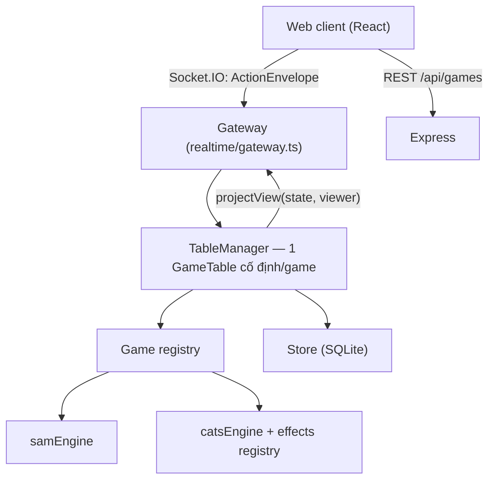

# Kiến trúc

## Lớp

| Lớp | Trách nhiệm |
|---|---|
| `packages/shared` | Kiểu giao thức (`TableView`, `ActionEnvelope`, `Ack`), tên sự kiện, metadata game, avatar, dữ liệu lá Mèo Nổ, luật tổ hợp Sâm thuần (để client gợi ý; server vẫn kiểm tra lại). |
| `GameEngine` | Giao diện chung: `parseConfig`, `validateStart`, `createRound`, `applyAction`, `getDeadline/onDeadline`, `onPlayerGone`, `shiftDeadlines`, `tablePolicy`, `isFinished`, `getOutcome`, `projectView`. Engine không biết gì về Socket.IO, React hay DB. |
| `GameTable` | Một bàn cố định: chỗ ngồi, sẵn sàng, trạng thái `WAITING → READY → PLAYING → ROUND_FINISHED → WAITING` (+ `PAUSED`, `CLOSED`), đóng băng cấu hình, idempotency theo `actionId`, kiểm tra `roundId`/`stateVersion`, hẹn giờ, mất kết nối, quyết toán, snapshot. |
| `Gateway` | Xác thực token, giới hạn tần suất (token bucket), định tuyến sự kiện, gộp thay đổi trong một tick và phát `TableView` riêng cho từng socket. |
| `Store` | SQLite (`node:sqlite`). Có thể thay bằng PostgreSQL/Prisma bằng cách cài đặt lại interface `Store`. |

## Mô hình dữ liệu (SQLite)

| Bảng | Ứng với thực thể |
|---|---|
| `players` | `Player` (id công khai, hash token, biệt danh, avatar) |
| `game_tables` | `GameTable` + `RulePreset` hiện hành (config JSON, trạng thái mở/đóng) |
| `table_snapshots` | Ảnh chụp trạng thái bàn (chỉ server đọc) để khôi phục khi khởi động lại |
| `game_sessions` | `GameSession` (ván, phiên bản luật, cấu hình đóng băng, người chơi, `settled`, kết quả) |
| `game_events` | `GameEvent` (log đã xác nhận, kèm `visible_to` và audit nội bộ) |
| `ledger` | Sổ cái bất biến: mỗi khoản thay đổi số dư, `UNIQUE(session_id, settlement_key)` |
| `balances` | Số dư tiền ảo theo người & game (số nguyên) |

## Bảo mật & tính đúng

- Token phiên 256-bit sinh ở server, DB chỉ lưu SHA-256; ID công khai (`p_xxx`) tách biệt token.
- Mật khẩu quản trị so sánh hằng-thời-gian; quyền admin gắn với phiên trong bộ nhớ.
- Mọi payload được kiểm tra bằng zod (`.strict()`), engine ném `GameRuleError` với thông báo tiếng Việt.
- `projectView` chỉ trả bài của chính người xem; khán giả và người chờ ván sau nhận bản công khai. Chồng bài rút không bao giờ rời server; ID lá Mèo Nổ là ngẫu nhiên nên không lộ vị trí.
- Lỗi nội bộ chỉ ghi `message` ra log, không in trạng thái ván.
- Không dùng `Math.random()` cho chia bài; `seededRng` chỉ dùng trong test.

## Mở rộng quy mô

Mỗi game chỉ có một bàn nên một tiến trình là đủ. Nếu cần nhiều instance: chuyển `Store` sang PostgreSQL, dùng `@socket.io/redis-adapter`, và chỉ định một instance làm chủ cho mỗi bàn (sticky theo `tableId`).
