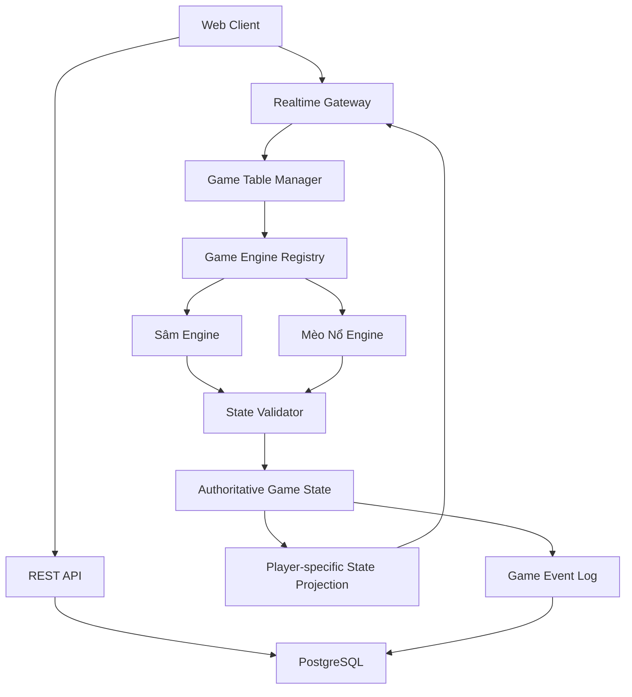

# Đặc tả sản phẩm: Nền tảng game bài multiplayer tiếng Việt

## 1. Tổng quan

### 1.1. Mục tiêu

Xây dựng một ứng dụng web tập hợp nhiều trò chơi bài có thể chơi trực tuyến cùng bạn bè. Ứng dụng ưu tiên trải nghiệm chơi trực tiếp, đơn giản: người chơi mở ứng dụng, chọn game và tham gia bàn chơi duy nhất của game đó.

Các yêu cầu cốt lõi:

- Toàn bộ giao diện, hướng dẫn, thông báo, luật chơi và nội dung trong game sử dụng tiếng Việt.
- Hỗ trợ multiplayer realtime.
- Mỗi game chỉ có **một bàn chơi chung duy nhất**. Không có chức năng tạo phòng, chia bàn, tạo nhiều bàn hay chọn bàn.
- Người chơi chọn game tương ứng và tham gia bàn chơi của game đó nếu còn chỗ.
- Mỗi game có giới hạn người chơi riêng.
- Mỗi game có cấu hình luật riêng.
- Hình ảnh minh họa sinh động, animation và hiệu ứng âm thanh.
- Có thể bổ sung game mới mà không phải viết lại toàn bộ hệ thống.
- Các loại tiền trong game Sâm là tiền ảo, không có giá trị quy đổi thành tiền thật.

### 1.2. Danh sách game ban đầu

#### Game 1: Sâm

- Game bài Việt Nam.
- Tối đa 5 người chơi.
- Có cấu hình tiền khởi đầu, tiền phạt theo số lá, tiền phạt các trường hợp đặc biệt và thưởng/phạt báo Sâm.
- Bộ luật cụ thể cần được xác nhận và triển khai trong game engine riêng.

#### Game 2: Mèo Nổ mở rộng

- Tối đa 8 người chơi.
- Game theo lượt, sử dụng các lá bài hành động và cơ chế Mèo Nổ.
- Hỗ trợ bộ bài mở rộng theo các module đã được triển khai.
- Có thể dùng bộ bài và hình minh họa nguyên bản do dự án tự thiết kế. Nếu muốn mô phỏng chính xác một phiên bản thương mại cụ thể, cần xác định phiên bản và bộ luật tương ứng.

## 2. Mô hình tham gia game

### 2.1. Một bàn duy nhất cho mỗi game

Mỗi game có một bàn chơi chung duy nhất trong toàn bộ ứng dụng:

- Bàn Sâm: tối đa 5 người chơi.
- Bàn Mèo Nổ: tối đa 8 người chơi.
- Không có chức năng tạo phòng riêng.
- Không có mã phòng, đường dẫn mời riêng hoặc danh sách nhiều phòng.
- Không có chức năng chuyển bàn.
- Người chơi bấm **Tham gia** trên trang của game để vào bàn tương ứng.
- Nếu bàn đã đủ người, hiển thị thông báo bàn đã đủ chỗ.
- Nếu game đang diễn ra, hệ thống áp dụng chính sách tham gia giữa ván đã cấu hình. Mặc định, người chơi mới phải chờ đến ván tiếp theo.
- Khi không có ván đang diễn ra, người chơi có thể tham gia hoặc rời bàn.
- Chủ sở hữu ứng dụng có thể cấu hình luật cho từng game. Trong MVP, quyền thay đổi cấu hình có thể được giới hạn cho quản trị viên hoặc một tài khoản chủ sở hữu được xác thực.

### 2.2. Trạng thái bàn chơi

Mỗi game có trạng thái bàn độc lập:

- `WAITING`: đang chờ người chơi.
- `READY`: đủ điều kiện bắt đầu hoặc đang chờ xác nhận sẵn sàng, nếu game có dùng cơ chế này.
- `PLAYING`: ván đang diễn ra.
- `ROUND_FINISHED`: ván đã kết thúc, đang hiển thị kết quả.
- `PAUSED`: tạm dừng theo chính sách quản trị hoặc xử lý sự cố.
- `CLOSED`: game tạm ngừng nhận người chơi.

Luồng trạng thái thông thường:

`WAITING -> READY -> PLAYING -> ROUND_FINISHED -> WAITING`

Không cần có thực thể `Room` dùng để tạo nhiều phòng. Thay vào đó, hệ thống có một thực thể `GameTable` hoặc `GameLobby` cố định cho mỗi game.

### 2.3. Luồng sử dụng

1. Người chơi mở trang chủ.
2. Chọn Sâm hoặc Mèo Nổ.
3. Xem giới thiệu, số người hiện tại và số chỗ còn trống.
4. Nhấn **Tham gia bàn**.
5. Nhập biệt danh hoặc xác thực danh tính theo cơ chế đăng nhập đã chọn.
6. Nếu bàn còn chỗ và cho phép tham gia, người chơi được thêm vào danh sách người chơi.
7. Người chơi chờ ván bắt đầu hoặc chờ ván kế tiếp.
8. Khi ván kết thúc, hiển thị kết quả và cho phép tiếp tục ván mới.
9. Người chơi có thể rời bàn; việc rời bàn trong lúc ván đang diễn ra tuân theo chính sách riêng của game.

## 3. Giao diện và trải nghiệm người dùng

### 3.1. Trang chủ

Trang chủ cần có:

- Logo và tên ứng dụng.
- Danh sách game dưới dạng thẻ hình ảnh.
- Tên game, mô tả ngắn, số người tối đa và số người đang tham gia.
- Trạng thái game: đang chờ, đang chơi hoặc tạm ngừng.
- Nút **Vào game** hoặc **Tham gia bàn**.
- Hồ sơ người chơi với biệt danh và avatar.
- Không hiển thị chức năng tạo phòng, mã phòng hoặc danh sách phòng.

Các game chưa triển khai có thể được hiển thị là “Sắp ra mắt”, nhưng không được xuất hiện như game đã chơi được.

### 3.2. Trang game và bàn chơi

Mỗi game có trang riêng, bao gồm:

- Tên game, mô tả ngắn và hướng dẫn luật.
- Số người đang tham gia / số người tối đa.
- Danh sách người chơi, avatar, biệt danh và trạng thái kết nối.
- Trạng thái hiện tại của bàn.
- Nút tham gia hoặc rời bàn phù hợp với trạng thái hiện tại.
- Khu vực cài đặt luật chỉ dành cho người có quyền.
- Bàn chơi có bố cục riêng theo từng game.
- Khu vực thao tác của người chơi hiện tại.
- Nhật ký sự kiện bằng tiếng Việt.
- Nút bật/tắt âm thanh, xem hướng dẫn và rời game.
- Hiệu ứng chuyển lượt, đánh bài, rút bài, chiến thắng và thất bại.

Không dùng chung một bố cục bàn cố định cho tất cả game. Các game có thể dùng chung thành phần giao diện, nhưng mỗi game được phép thiết kế khu vực chơi riêng.

### 3.3. Thiết kế bàn chơi

- Desktop: bố cục rộng, thông tin người chơi xung quanh bàn.
- Mobile: bố cục dọc, bài trên tay có thể cuộn ngang, nút thao tác đủ lớn.
- Tablet: tự điều chỉnh vị trí người chơi và khu vực bài.
- Không phụ thuộc hover để thực hiện hành động quan trọng.
- Khi mất kết nối, hiển thị trạng thái kết nối lại thay vì đưa người chơi về trang chủ.
- Hiển thị rõ người đang đến lượt, số bài còn lại hoặc trạng thái sống/đã bị loại, tùy game.

### 3.4. Ngôn ngữ và khả năng tiếp cận

- Toàn bộ giao diện người dùng phải bằng tiếng Việt.
- Sử dụng nội dung ngắn gọn, dễ hiểu.
- Đảm bảo độ tương phản và khả năng đọc trên màn hình nhỏ.
- Các nút cảm ứng đủ lớn trên thiết bị di động.
- Có trạng thái tải, lỗi, mất kết nối và kết nối lại rõ ràng.

## 4. Game Sâm

### 4.1. Tổng quan

- Số người chơi: 2–5.
- Sử dụng bộ bài Tây 52 lá.
- Mỗi người được chia bài theo biến thể luật đã chọn.
- Người chơi lần lượt đánh tổ hợp bài hợp lệ hoặc bỏ lượt.
- Mục tiêu là đánh hết bài trên tay trước những người chơi khác.
- Các tình huống đặc biệt như báo Sâm, chặt 2, tứ quý, thối 2 và kết thúc ván phải được xử lý theo bộ luật đã xác nhận.

Sâm có nhiều biến thể. Không viết luật rải rác trong giao diện. Xây dựng bộ luật có thể cấu hình, kiểm thử và mở rộng.

### 4.2. Cấu hình Sâm

Chủ sở hữu hoặc quản trị viên được cấp quyền có thể cấu hình:

- Số người chơi tối đa, không vượt quá 5.
- Số dư tiền ảo khởi đầu.
- Mức tiền phạt theo mỗi lá còn lại.
- Mức phạt thối 2.
- Mức phạt khi bị chặt 2.
- Mức phạt khi bị chặt bởi tứ quý hoặc tổ hợp đặc biệt.
- Thưởng khi báo Sâm thành công.
- Phạt khi báo Sâm thất bại hoặc bị chặn.
- Có bật luật ăn trắng hay không.
- Có bật luật tứ quý chặt 2 hay không.
- Quy tắc đánh 2 cuối cùng.
- Công thức tính tiền khi thắng hoặc thua.
- Giới hạn hợp lệ cho các giá trị cấu hình.

Cấu hình được kiểm tra ở server. Khi ván bắt đầu, cấu hình được đóng băng và không thay đổi giữa ván.

### 4.3. Bộ máy luật Sâm

Các trạng thái chính:

1. `WAITING`: chờ người chơi.
2. `DEALING`: server xáo bài và chia bài.
3. `PLAYING`: người chơi đánh bài hoặc bỏ lượt.
4. `SAM_DECLARED`: đang xử lý tình huống báo Sâm, nếu áp dụng.
5. `ROUND_FINISHED`: ván kết thúc, tính kết quả.
6. `NEXT_ROUND`: chuẩn bị ván tiếp theo.

#### Tổ hợp bài

Tùy theo bộ luật đã xác nhận, hỗ trợ:

- Bài lẻ.
- Đôi.
- Sám cô.
- Sảnh.
- Các tổ hợp khác nếu biến thể luật yêu cầu.
- So sánh độ mạnh của các tổ hợp cùng loại.
- Kiểm tra tổ hợp được đánh có tồn tại trong bài của người chơi hay không.

#### Chặn bài và bỏ lượt

- Kiểm tra tổ hợp được đánh có chặn được tổ hợp hiện tại không.
- Xử lý bỏ lượt.
- Xác định điều kiện kết thúc một vòng đánh.
- Xác định người được đánh đầu vòng tiếp theo.
- Xử lý 2, tứ quý và các trường hợp đặc biệt theo cấu hình.

#### Báo Sâm

- Chỉ cho phép báo Sâm tại thời điểm hợp lệ.
- Server xác minh hành động.
- Theo dõi các lượt đánh cho đến khi báo Sâm thành công hoặc bị chặn.
- Tính thưởng/phạt theo cấu hình.
- Lưu lịch sử sự kiện để kiểm tra khi có tranh chấp.

#### Kết thúc ván

- Xác định người thắng.
- Xác định trường hợp thắng đặc biệt.
- Tính tiền ảo cho từng người.
- Đảm bảo mỗi ván chỉ được quyết toán một lần.
- Hiển thị bài còn lại, tiền thay đổi và số dư mới.

### 4.4. Engine tính tiền Sâm

Tách phần tính tiền thành module riêng, ví dụ `SamScoringEngine`.

Các sự kiện có thể bao gồm:

| Sự kiện | Xử lý |
|---|---|
| Thắng bình thường | Cộng tiền theo công thức đã cấu hình |
| Thua bình thường | Trừ tiền theo số lá còn lại hoặc công thức đã chọn |
| Thối 2 | Áp dụng mức phạt thối 2 |
| Bị chặt | Áp dụng mức phạt theo tổ hợp chặt |
| Báo Sâm thành công | Áp dụng thưởng theo luật |
| Báo Sâm thất bại | Áp dụng phạt theo luật |

Không tự chọn công thức phân phối tiền, hệ số nhân hoặc thứ tự ưu tiên giữa các khoản phạt nếu chưa được xác nhận.

## 5. Game Mèo Nổ mở rộng

### 5.1. Tổng quan

- Số người chơi: 2–8.
- Game theo lượt.
- Người chơi sử dụng bài hành động để tạo lợi thế, tác động đến đối thủ hoặc điều chỉnh rủi ro.
- Cuối lượt, người chơi rút bài theo luật hiện hành.
- Nếu rút phải lá Mèo Nổ mà không có phương án xử lý hợp lệ, người chơi bị loại.
- Trò chơi tiếp tục đến khi xác định người thắng theo bộ luật đã chọn.

Đối với game lấy cảm hứng từ Mèo Nổ, ưu tiên dùng bộ bài, tên gọi, mô tả và hình minh họa nguyên bản. Nếu yêu cầu mô phỏng một phiên bản thương mại cụ thể, phải xác định rõ phiên bản, bộ mở rộng và luật được phép triển khai.

### 5.2. Các nhóm bài

Danh mục dưới đây là nhóm chức năng tham khảo, không phải danh sách bài chính thức:

- **Mèo Nổ:** lá gây nguy hiểm; người chơi cần xử lý theo luật nếu rút phải.
- **Gỡ Bom:** cho phép xử lý Mèo Nổ theo luật đã định nghĩa.
- **Lá hành động:** bỏ lượt, tác động lượt, chọn mục tiêu hoặc tác động tới bài.
- **Lá bộ sưu tập:** có thể tham gia tổ hợp hoặc hiệu ứng kết hợp.
- **Lá mở rộng:** hiệu ứng bổ sung được triển khai trong các module riêng.

Tên, số lượng, tác dụng và điều kiện sử dụng của từng lá phải được định nghĩa trong dữ liệu game.

### 5.3. Cấu hình game

Người có quyền cấu hình có thể chọn:

- Số người chơi, tối đa 8.
- Bộ bài cơ bản hoặc bộ mở rộng đã được hỗ trợ.
- Các module mở rộng được bật/tắt.
- Các tùy chọn luật có hỗ trợ.
- Thời gian tối đa mỗi lượt.
- Chính sách xử lý người chơi mất kết nối.
- Chính sách tham gia khi ván đang diễn ra.

Server phải kiểm tra bộ bài có hợp lệ với số người chơi và bộ luật đã chọn. Nếu không đủ điều kiện khởi tạo ván, hiển thị lỗi rõ ràng.

### 5.4. Vòng đời lượt chơi

1. Bắt đầu lượt và xác định người chơi hiện tại.
2. Xử lý các hiệu ứng còn tồn tại.
3. Người chơi đánh các lá hành động hợp lệ.
4. Server xử lý hiệu ứng và lựa chọn mục tiêu.
5. Người chơi rút bài theo luật.
6. Kiểm tra điều kiện loại người chơi hoặc kết thúc ván.
7. Nếu ván chưa kết thúc, xác định người chơi tiếp theo.

### 5.5. Engine hiệu ứng bài

Mỗi lá bài được định nghĩa bằng dữ liệu và loại hiệu ứng, không hard-code toàn bộ trong component giao diện.

Ví dụ TypeScript:

```ts
type CardDefinition = {
  id: string;
  name: string;
  description: string;
  imageKey: string;
  category: string;
  expansionId: string;
  effectType: string;
  targetMode: "self" | "player" | "all" | "none";
  requiresTarget: boolean;
  requiresChoice: boolean;
};
```

Các loại hiệu ứng có thể bao gồm:

- Bỏ lượt hoặc thay đổi số lượt.
- Bắt người chơi khác thực hiện hành động.
- Chọn người chơi mục tiêu.
- Lấy hoặc trao đổi bài.
- Xem thông tin được luật cho phép.
- Thay đổi thứ tự lượt.
- Đặt lại bài vào bộ bài.
- Kết hợp lá để kích hoạt hiệu ứng.
- Hiệu ứng riêng của bộ mở rộng.

Chỉ triển khai các hiệu ứng đã có luật rõ ràng. Mỗi hiệu ứng cần khai báo:

1. Điều kiện sử dụng.
2. Số lượng mục tiêu.
3. Lựa chọn cần có.
4. Thay đổi trạng thái hợp lệ.
5. Cách hủy hoặc xử lý khi không thể hoàn thành.
6. Các bước tiếp theo của lượt.
7. Điều kiện kết thúc ván.

Không cho phép dữ liệu lá bài thực thi JavaScript tùy ý. `effectType` phải được ánh xạ tới handler được server cho phép.

### 5.6. Dữ liệu công khai và riêng tư

- Số bài trên tay mỗi người: công khai.
- Nội dung bài trên tay: chỉ người sở hữu được xem, trừ khi hiệu ứng cho phép.
- Bài trong bộ bài rút: không được lộ.
- Bài ở chồng bài bỏ: công khai theo luật.
- Lựa chọn bí mật: chỉ công khai khi luật yêu cầu.
- Trạng thái bị loại, lượt hiện tại và hiệu ứng công khai: đồng bộ cho mọi người.

Không gửi toàn bộ bộ bài xuống client rồi chỉ che bằng CSS.

## 6. Multiplayer realtime

### 6.1. Quản lý bàn chơi

Mỗi game có một bản ghi bàn cố định:

- ID game.
- Trạng thái bàn.
- Danh sách người chơi hiện tại.
- Giới hạn số người chơi.
- Cấu hình luật hiện hành.
- Ván hiện tại.
- Phiên bản trạng thái.
- Thời điểm tạo và hoạt động gần nhất.

Không xây dựng hệ thống tạo nhiều phòng hoặc nhiều bàn. Các định danh `GameTable` cần ổn định, ví dụ `sam-main-table` và `exploding-cats-main-table`.

### 6.2. Đồng bộ realtime

Sử dụng WebSocket hoặc Socket.IO để đồng bộ:

- Người chơi tham gia hoặc rời bàn.
- Trạng thái sẵn sàng.
- Bắt đầu ván.
- Đánh bài, bỏ lượt và rút bài.
- Chọn mục tiêu, xác nhận hành động.
- Chuyển lượt.
- Cập nhật trạng thái ván.
- Kết thúc ván và kết quả.
- Mất kết nối và kết nối lại.

Mỗi hành động gửi lên server cần có:

- ID hành động duy nhất.
- ID game và bàn.
- ID ván.
- Người gửi đã được xác thực.
- Phiên bản trạng thái client đang biết.
- Payload hành động.

Server xác thực người chơi, quyền, lượt và luật trước khi cập nhật trạng thái. Gửi cùng một hành động nhiều lần không được khiến hành động hoặc quyết toán bị áp dụng nhiều lần.

### 6.3. Tham gia khi ván đang diễn ra

Mặc định:

- Người chơi mới có thể xem trạng thái công khai của game.
- Không cho người chơi mới tham gia giữa ván nếu luật game không hỗ trợ.
- Người chơi mới có thể đăng ký chờ ván kế tiếp nếu bàn còn khả năng tiếp nhận.
- Không tự ý thêm người chơi vào một ván đã khởi tạo.
- Khi ván kết thúc, hệ thống thông báo và cho phép người đang chờ tham gia ván tiếp theo.

Chính sách chính xác cần được áp dụng nhất quán giữa giao diện và server.

### 6.4. Mất kết nối

- Giữ trạng thái ván trên server khi người chơi mất kết nối tạm thời.
- Cho phép quay lại bằng phiên đã được xác thực.
- Chỉ gửi dữ liệu mà người chơi có quyền xem.
- Hiển thị “Đang kết nối lại”.
- Có chính sách timeout riêng cho từng game.
- Không loại người chơi ngay khi refresh hoặc mất một gói tin.
- Xử lý người chơi mất kết nối quá lâu theo luật đã định nghĩa.

## 7. Kiến trúc kỹ thuật

### 7.1. Công nghệ đề xuất

Nếu repository chưa có stack phù hợp, cân nhắc:

- **Frontend:** Next.js, React, TypeScript.
- **UI:** Tailwind CSS và thư viện component phù hợp.
- **Realtime:** Socket.IO.
- **Backend:** Node.js và TypeScript.
- **Database:** PostgreSQL và Prisma.
- **Testing:** Vitest cho unit/integration tests và Playwright cho end-to-end tests.

Codex phải kiểm tra repository trước khi chọn hoặc thay đổi công nghệ. Không thay toàn bộ stack đang hoạt động nếu không có lý do rõ ràng.

### 7.2. Kiến trúc logic



Nguyên tắc:

1. Server là nguồn dữ liệu chính thức.
2. Client gửi ý định hành động và hiển thị kết quả server trả về.
3. Game engine không phụ thuộc vào React hoặc transport.
4. Mỗi game có bộ luật, trạng thái và bộ kiểm thử độc lập.
5. Trạng thái riêng tư được lọc trước khi gửi cho từng người.
6. Các thao tác quyết toán phải idempotent.
7. Lưu phiên bản luật dùng trong từng ván.
8. Game Table Manager quản lý một bàn cố định cho mỗi game, không tạo bàn mới.

### 7.3. Cấu trúc thư mục tham khảo

```text
apps/
  web/
    app/
    components/
    features/
      lobby/
      sam/
      exploding-cats/
    styles/

  server/
    src/
      api/
      realtime/
      game-tables/
      auth/
      game-registry/
      games/
        sam/
          engine.ts
          rules.ts
          scoring.ts
          validators.ts
          events.ts
        exploding-cats/
          engine.ts
          cards.ts
          effects/
          validators.ts
      state/
      persistence/
      security/

packages/
  shared/
    types/
    events/
    schemas/
  game-ui/
    components/
    animations/

tests/
  unit/
  integration/
  e2e/

docs/
  product-requirements.md
  game-rules/
  architecture.md
```

Điều chỉnh cấu trúc theo repository thực tế. Tránh tạo package không cần thiết cho một dự án nhỏ.

## 8. Mô hình dữ liệu

Các thực thể cơ bản:

| Thực thể | Mục đích |
|---|---|
| `Player` | Định danh người chơi, biệt danh và avatar |
| `GameDefinition` | Metadata, hình ảnh, số người chơi và phiên bản game |
| `GameTable` | Bàn cố định duy nhất của một game |
| `TablePlayer` | Người chơi tại bàn, thứ tự ghế và trạng thái kết nối |
| `GameSession` | Một ván cụ thể, phiên bản luật và trạng thái |
| `GameEvent` | Lịch sử hành động đã được server xác nhận |
| `RoundResult` | Người thắng, kết quả và thay đổi tiền ảo |
| `RulePreset` | Cấu hình luật mặc định hoặc được quản trị viên lưu |

Không cần thực thể `Room` để tạo nhiều phòng.

Ví dụ kiểu dữ liệu game:

```ts
type GameDefinition = {
  id: string;
  name: string;
  description: string;
  minPlayers: number;
  maxPlayers: number;
  rulesVersion: string;
  assetManifest: Record<string, string>;
};
```

Mỗi game cần schema cấu hình riêng. Server kiểm tra cấu hình khi thay đổi luật và trước khi bắt đầu ván.

Với Sâm:

- Dùng số nguyên cho đơn vị tiền ảo.
- Mỗi khoản thay đổi số dư phải có sự kiện quyết toán duy nhất.
- Không sử dụng số thực cho các phép tính tiền.
- Lưu lịch sử thay đổi để kiểm tra kết quả.

## 9. Hình ảnh, âm thanh và animation

### 9.1. Phong cách nghệ thuật

- Màu sắc tươi sáng, thân thiện, hiện đại.
- Độ tương phản cao và dễ đọc trên màn hình nhỏ.
- Lá bài có hình minh họa riêng.
- Avatar đa dạng, biểu cảm rõ ràng.
- Animation ngắn, mượt và không che thông tin.
- Mỗi game có phong cách riêng nhưng dùng chung design system.

Sâm có thể sử dụng phong cách bài Tây dễ nhận diện và bàn chơi gọn gàng. Mèo Nổ có thể dùng phong cách hoạt hình vui nhộn với minh họa riêng cho từng lá.

### 9.2. Danh mục asset

- Logo ứng dụng.
- Hình cover cho từng game.
- Avatar mặc định.
- Bộ mặt bài 52 lá cho Sâm.
- Mặt sau lá bài.
- Hình minh họa riêng cho Mèo Nổ.
- Nền bàn chơi.
- Icon trạng thái và nút thao tác.
- Hiệu ứng chiến thắng, thất bại và thông báo.
- Âm thanh đánh bài, rút bài, chuyển lượt và kết thúc ván.

Quản lý asset bằng manifest với tên định danh ổn định. Không gắn đường dẫn hình ảnh rải rác trong code. Ưu tiên asset tự tạo hoặc có giấy phép phù hợp. Emoji chỉ dùng làm placeholder trong prototype.

## 10. Bảo mật và tính đúng đắn

- Không để client quyết định bài được chia hoặc kết quả thắng.
- Không gửi bài ẩn của đối thủ xuống trình duyệt.
- Kiểm tra quyền người chơi ở mọi hành động.
- Kiểm tra lượt và tính hợp lệ của bài ở server.
- Không tin số dư, điểm số hoặc trạng thái do client gửi.
- Chống gửi lại sự kiện để nhân đôi kết quả.
- Giới hạn tần suất gửi sự kiện.
- Tách biệt ID công khai và thông tin xác thực.
- Không đưa secret vào bundle frontend.
- Ghi log lỗi mà không làm lộ bài riêng tư.
- Kiểm thử tình huống đồng thời, mất kết nối và hành động không hợp lệ.
- Dùng bộ sinh số ngẫu nhiên phù hợp cho server và thuật toán xáo bài không thiên lệch; không dùng `Math.random()` cho việc chia bài có tính bảo mật.

## 11. Phạm vi MVP và lộ trình

### Giai đoạn 1: Nền tảng

- Trang chủ với danh sách game.
- Biệt danh và avatar.
- Một bàn duy nhất cho mỗi game.
- Tham gia/rời bàn.
- Trạng thái số người hiện tại và số chỗ còn trống.
- Realtime connectivity.
- Giao diện responsive và design system.
- Cấu hình luật chỉ dành cho người có quyền.

### Giai đoạn 2: Sâm

- Hỗ trợ 2–5 người.
- Chia bài, đánh bài, bỏ lượt và kiểm tra tổ hợp.
- Xử lý luật đặc biệt đã được xác nhận.
- Cấu hình tiền ảo.
- Tính kết quả và lịch sử.
- Kiểm thử luật bằng các tình huống mẫu.

### Giai đoạn 3: Mèo Nổ mở rộng

- Hỗ trợ tối đa 8 người.
- Bộ bài, lượt chơi và điều kiện loại.
- Engine xử lý hiệu ứng và mục tiêu.
- Hỗ trợ các bộ mở rộng đã định nghĩa.
- Kiểm thử tương tác giữa các hiệu ứng.

### Giai đoạn 4: Hoàn thiện

- Kiểm thử nhiều client đồng thời.
- Kiểm thử bảo mật và quyền riêng tư.
- Tối ưu mobile.
- Hoàn thiện animation, âm thanh và thông báo.
- Cấu hình triển khai và tài liệu vận hành.

## 12. Tiêu chí nghiệm thu

| Hạng mục | Điều kiện đạt |
|---|---|
| Bàn chơi | Mỗi game chỉ có một bàn cố định; không có chức năng tạo phòng hoặc chia bàn |
| Số lượng | Sâm tối đa 5, Mèo Nổ tối đa 8 |
| Tham gia | Người chơi có thể tham gia bàn tương ứng nếu còn chỗ và chính sách cho phép |
| Đồng bộ | Các client nhận cùng trạng thái công khai của ván |
| Luật | Hành động sai bị server từ chối |
| Bài riêng tư | Người chơi không thể xem bài đối thủ qua dữ liệu client |
| Kết quả | Một ván chỉ quyết toán một lần |
| Kết nối lại | Người chơi có thể kết nối lại theo chính sách đã định nghĩa |
| Ngôn ngữ | Không có nội dung giao diện người dùng bằng tiếng Anh |
| Mở rộng | Có thể đăng ký thêm game mà không viết lại bộ quản lý bàn chơi |

Không đánh dấu một tính năng là hoàn tất chỉ vì giao diện đã tồn tại. Tính năng chỉ được xem là hoàn tất khi các chuyển đổi trạng thái server hoạt động và được kiểm thử.

## 13. Prompt triển khai cho Codex

### Vai trò

Act as a senior full-stack engineer, game systems architect, and UI/UX engineer. Build a production-minded, extensible Vietnamese multiplayer card game platform.

All user-facing UI, game content, error messages, tooltips, instructions, and notifications must be in Vietnamese.

### Trước khi triển khai

1. Kiểm tra repository hiện tại, framework, package manager, cấu trúc và quy ước code.
2. Tái sử dụng kiến trúc hiện có khi hợp lý.
3. Nếu repository trống, đề xuất và triển khai kiến trúc TypeScript full-stack phù hợp.
4. Viết kế hoạch ngắn và liệt kê các câu hỏi luật chơi chưa được xác nhận.
5. Không tự bịa luật còn thiếu; tạo module cấu hình rõ ràng và ghi lại những điểm chưa chốt.
6. Không dừng ở việc tạo kế hoạch. Triển khai từng phần nhỏ có thể chạy và kiểm thử.

### Yêu cầu sản phẩm

Tạo nền tảng game bài multiplayer với trang chủ, định danh người chơi, quản lý bàn cố định, cấu hình luật, realtime, bàn chơi, lịch sử và game engine dạng module.

Game ban đầu:

1. Sâm, hỗ trợ 2–5 người.
2. Game lấy cảm hứng từ Mèo Nổ, hỗ trợ 2–8 người và có thể mở rộng hiệu ứng bài.

**Mỗi game chỉ có một bàn chơi duy nhất. Không triển khai tạo phòng, mã phòng, nhiều bàn, chuyển bàn hoặc danh sách phòng.** Người chơi chọn game và tham gia bàn tương ứng. Khi bàn đầy hoặc ván không cho phép tham gia giữa chừng, hiển thị trạng thái và hướng dẫn phù hợp.

Game sử dụng tiền ảo trong ứng dụng, không triển khai cờ bạc tiền thật, nạp/rút tiền hoặc quy đổi tiền.

### UI và thiết kế

- Giao diện sinh động, hiện đại, không phải admin dashboard chung chung.
- Responsive trên desktop, tablet và mobile.
- Trang chủ có thẻ game minh họa.
- Trang game hiển thị số người hiện tại, số chỗ còn trống, danh sách người chơi và trạng thái ván.
- Có nút tham gia/rời bàn theo trạng thái.
- Bàn chơi riêng cho Sâm và Mèo Nổ.
- Lá bài, avatar, nền bàn và animation riêng.
- Hiển thị lượt hiện tại, lịch sử sự kiện, trạng thái tải/lỗi/mất kết nối.
- Tất cả UI bằng tiếng Việt.
- Sử dụng asset tự tạo hoặc có giấy phép phù hợp.
- Không dùng emoji làm hình minh họa cuối cùng.

### Kiến trúc multiplayer

Server phải quản lý toàn bộ trạng thái chính thức, bao gồm người chơi tại bàn, khởi tạo ván, chia bài, bài riêng tư/công khai, thứ tự lượt, xác thực hành động, hiệu ứng, kết thúc ván, quyết toán, kết nối lại và lịch sử sự kiện.

Client chỉ gửi ý định hành động. Server kiểm tra quyền, lượt, trạng thái và luật trước khi áp dụng.

Mỗi hành động có ID duy nhất, game/table ID, session ID, người gửi đã xác thực, phiên bản trạng thái và payload. Hành động gửi lặp không được áp dụng nhiều lần.

Không gửi bài của đối thủ hoặc bộ bài rút ẩn xuống client.

### Game engine

Xây dựng giao diện engine dùng chung để:

- Xác thực cấu hình game.
- Khởi tạo ván.
- Tạo trạng thái riêng cho từng người chơi.
- Liệt kê hoặc xác thực hành động hợp lệ.
- Áp dụng hành động.
- Chuyển lượt.
- Xác định kết thúc ván.
- Tạo kết quả và sự kiện quyết toán.

Game engine không phụ thuộc React hoặc lớp truyền tải realtime. Đăng ký game thông qua registry. Mỗi game có rules version riêng và phiên bản luật được lưu trong từng ván.

### Yêu cầu Sâm

- Hỗ trợ 2–5 người và bộ bài 52 lá.
- Triển khai tổ hợp bài, chặn bài, bỏ lượt và kết thúc ván theo luật được xác nhận.
- Cấu hình tiền ảo khởi đầu, tiền phạt mỗi lá, tiền phạt 2/tứ quý và thưởng/phạt báo Sâm.
- Tách riêng scoring engine.
- Không tự bịa công thức tính tiền hoặc luật đặc biệt chưa được chốt.
- Bổ sung unit tests cho tổ hợp hợp lệ/không hợp lệ, chặn bài, lượt và quyết toán.

### Yêu cầu Mèo Nổ

- Hỗ trợ 2–8 người.
- Xây dựng định nghĩa bài dạng dữ liệu và registry handler hiệu ứng phía server.
- Hỗ trợ cấu hình bộ bài và các module mở rộng đã triển khai.
- Chỉ triển khai hiệu ứng có luật rõ ràng.
- Không thực thi JavaScript tùy ý từ dữ liệu bài.
- Giữ kín bài trên tay và bộ bài rút.
- Kiểm tra bộ bài tương thích với số người và luật đã chọn.

### Lưu trữ

Lưu định danh người chơi, bàn cố định, người chơi tại bàn, game session, cấu hình luật, phiên bản luật, sự kiện và kết quả. Dùng PostgreSQL và Prisma nếu repository chưa có giải pháp phù hợp.

Sử dụng số nguyên cho tiền ảo. Lưu thay đổi số dư bằng ledger hoặc bản ghi quyết toán bất biến tương đương. Chống quyết toán trùng.

### Bảo mật và độ tin cậy

- Validate mọi input ở server.
- Kiểm tra quyền, thành viên bàn và lượt.
- Từ chối hành động sai hoặc lỗi thời.
- Giới hạn tần suất hành động realtime.
- Dùng bộ sinh số ngẫu nhiên phù hợp và thuật toán xáo bài không thiên lệch.
- Không đưa secret vào frontend.
- Xử lý mất kết nối và kết nối lại mà không làm hỏng trạng thái.
- Chống quyết toán trùng và cập nhật đồng thời không nhất quán.
- Thêm unit, integration và end-to-end tests.
- Không để lộ trạng thái riêng tư trong payload, log hoặc lỗi.

### Trình tự triển khai

1. Kiểm tra repository và kiến trúc.
2. Xây dựng design system, trang chủ, định danh người chơi, bàn cố định cho mỗi game, tham gia/rời bàn và realtime.
3. Xây dựng Sâm, cấu hình luật, scoring và tests.
4. Xây dựng Mèo Nổ, hiệu ứng bài, cấu hình mở rộng và tests.
5. Hoàn thiện kết nối lại, bảo mật, mobile, asset, end-to-end tests và tài liệu.

Sau mỗi giai đoạn, chạy các kiểm tra có sẵn, sửa lỗi và báo cáo phần đã hoạt động cùng phần còn thiếu.

### Điều kiện hoàn thành

- Có thể chạy local theo hướng dẫn.
- Người chơi trên nhiều browser session tham gia cùng bàn của một game.
- Mỗi game chỉ có một bàn, không có hệ thống tạo phòng.
- Sâm hỗ trợ tối đa 5 người và tuân thủ luật đã cấu hình.
- Mèo Nổ hỗ trợ tối đa 8 người và hiệu ứng đã triển khai hoạt động đúng.
- Trạng thái có thẩm quyền ở server và thông tin riêng tư được bảo vệ.
- Kết quả và tiền ảo nhất quán.
- Giao diện tiếng Việt, responsive.
- Automated tests đạt.
- README mô tả setup, biến môi trường, kiến trúc, luật, kiểm thử và triển khai.

Bắt đầu bằng việc kiểm tra repository, sau đó xây dựng một luồng chơi end-to-end nhỏ nhất nhưng thực sự hoạt động. Tiếp tục triển khai theo từng giai đoạn; không thay thế tính năng thật bằng giao diện mock tĩnh.

## 14. Các quyết định cần xác nhận trước khi hoàn thiện game engine

Các mục sau có thể được quyết định trong quá trình làm rõ yêu cầu:

1. **Luật Sâm:** Sâm lốc phổ biến ở miền Bắc hay luật riêng của nhóm?
2. **Tính tiền Sâm:** theo số lá còn lại, người thua trả người thắng, hay công thức tùy chỉnh hoàn toàn?
3. **Mèo Nổ:** game lấy cảm hứng với bộ bài nguyên bản, mô phỏng bộ cơ bản hay hỗ trợ những bộ mở rộng cụ thể?
4. **Định danh người chơi:** vào nhanh bằng biệt danh, tài khoản đăng nhập, hay cả hai?
5. **Triển khai:** chạy local trước, triển khai online ngay hay hỗ trợ cả hai?
6. **Phong cách hình ảnh:** hoạt hình vui nhộn, cao cấp hiện đại hay kết hợp bản sắc Việt Nam?

Các quyết định chưa xác nhận phải được ghi lại. Không tự ý biến giá trị minh họa thành luật chính thức.
